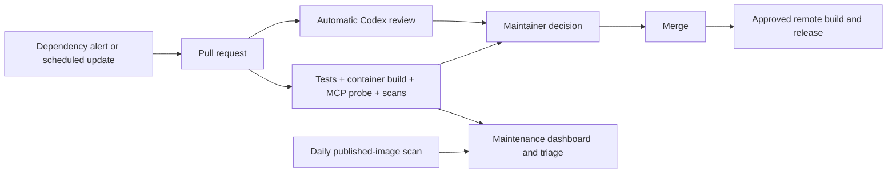

# Maintenance pilot

## Maintainer workflow

1. Open the **Maintenance dashboard** issue for actionable PRs, monitoring gaps and
   links to security alerts. GitHub is the source of truth; Pages can link to this
   issue without duplicating task status. Human decisions belong below its generated block.
2. Open a PR, inspect its current checks and Codex findings. A green check means
   only that particular check passed, not that the change is safe or reviewed.
3. Approve and merge explicitly. Never auto-merge dependency updates during this pilot.
4. Approve a release and build its exact merged commit on `remote-docker-builder`.
   Run the same container probe and vulnerability scan there before separately
   authorizing registry publication. A published image is not a deployed update.

## What the repository configures

| Layer | Trigger | Result |
|---|---|---|
| Dependabot version updates | Weekly | Python, Actions and Docker PRs; major upgrades stay separate |
| Python tests | PR / main or dev push | Locked dependency install, lint, formatting, tests on 3.11-3.14 |
| Candidate container | PR / main push / daily / manual | Build without push; health, rejected auth, authenticated MCP session, catalog and read against fake NetBox |
| Candidate vulnerability scan | After candidate build/probe | High/critical gate, including vulnerabilities with no fix |
| Published image scan | Daily at 06:23 UTC / manual | Pull current Docker Hub image, retain digest and scan results |
| CodeQL | PR / main push / Monday 06:43 UTC / manual | Python security analysis; alerts in Security, not necessarily a failing analysis job |
| Dashboard | Check completion / daily 08:53 UTC / manual | One updated issue; current-revision PR checks/reviews, stale work, missing scheduled coverage |
| Reporter dry run | PR / main push / daily / manual | Real GitHub reads with read-only permissions; simulated issue writes verify API access without modifying issues |
| CODEOWNERS | New non-draft PR after this file reaches main | Request `skuldgerry` review when eligible, including Dependabot changes |

Schedules run on the default branch and can be delayed by GitHub. They do not
become active merely because this PR exists. `workflow_run` reporting also requires
its workflow on the default branch. Repositories with no activity can have
scheduled Actions paused by GitHub; an external watchdog is needed to detect
complete Actions disablement. The tracker cannot report its own total outage.

## One-time activation checklist

Current validation evidence and merge readiness are recorded in
[PR #11](https://github.com/skuldgerry/netbox-mcp/pull/11). Always check the latest
revision rather than reusing a passing result from an older commit.

- [ ] Merge the pilot only after its PR checks and review are satisfactory.
- [x] Enable dependency graph, Dependabot alerts and **security updates** in repo
  settings. A `dependabot.yml` version-update schedule does not enable these settings.
- [x] In [Codex Code Review settings](https://chatgpt.com/settings/code-review), make
  this repository available and select **All PRs**, including bot-authored PRs;
  use a trigger that reviews new revisions. Personal preferences alone can miss
  Dependabot authors. Confirm a review actually appears on a representative PR.
- [ ] For existing PRs, request the maintainer's review once or refresh after rollout;
  adding CODEOWNERS is not a guarantee of retroactive review requests.
- [ ] After the new check names appear, require Python tests, compose, candidate
  container/security, and relevant code-scanning results in the main branch rules.
  Preserve existing rules and explicitly consider the sole-maintainer case: an
  author cannot approve their own PR. Do not lock out maintainer-authored work by
  blindly requiring a second human who does not exist. Bot PRs can be approved by
  the maintainer. No auto-merge or bypass is configured by this pilot.
- [ ] Run Maintenance manually on main to establish published-image coverage,
  then verify the first scheduled run and dashboard update.
- [ ] Verify access to Security alerts using the reporter job's API-read notices.
  Dependabot requires `vulnerability-alerts: read` on `GITHUB_TOKEN`; `security-events: read`
  covers Code Scanning instead. No PAT is required for this read-only path. A denied
  request remains UNKNOWN, never zero alerts, and an overall successful reporter job
  alone does not prove alert access. Keep GitHub's native security notifications enabled.

The reporter's required-job list is a coverage check, not branch protection. Inspect
the repository's actual branch rules separately before claiming checks are enforced.
Likewise, a disabled tracker workflow must be re-enabled by an explicit maintainer
decision; a code change does not restore its execution. Manual or push runs do not
replace evidence from runs whose event is `schedule`.
- [ ] Subscribe the maintainer to relevant GitHub security/Actions notifications.
  No email, chat webhook, paid review credits or production credentials are enabled here.
- [ ] Validate approved-release build and publication separately on the dedicated
  builder; runner registration and registry secrets are not part of this PR.

## Security decisions

- Start conservatively: all HIGH/CRITICAL image findings block the candidate check,
  even without a published fix. Scanner severity alone does not prove exploitability.
- Triage newly critical findings promptly: confirm installed version, runtime use,
  exposure and exploitation evidence; then update, mitigate or document a bounded
  exception with owner, rationale and expiry in a reviewed PR.
- Never silently ignore all unfixed vulnerabilities. Scanner/download/auth failures
  are monitoring failures, not healthy scans. Keep raw JSON evidence for 14 days.
- Store advisory details and remediation discussions in appropriate Security/private
  channels. The public dashboard exposes only counts, generic states and links.
- Builds and tests run on ephemeral GitHub-hosted machines with no lab connection,
  no real NetBox token, no registry push credentials and no persistent self-hosted runner.
- The runtime image intentionally omits pip and ensurepip, including their bundled
  dependencies. Install packages in the builder and release a new image; do not
  install packages or bootstrap environments inside a running service container.
- The write-enabled reporter checks out only trusted default-branch code. It must
  never run PR code or download PR artifacts. All API collections are paginated.
- Review and scanner output are advisory evidence, not authorization for external actions.

## Public and private repositories

Use the same stages and adapt language tests, image identity, smoke probe and owner.
Dependabot and ordinary Actions checks can cover both. Private registries require
explicit read-only scan credentials. Private CodeQL requires the appropriate
GitHub plan/licence; set `CODEQL_ENABLED=true` only after verifying eligibility.
Otherwise provide a suitable licensed/open-source analysis alternative and clearly
record the coverage gap. Do not label a skipped private CodeQL job as code coverage.

For an organization, replace the dashboard assignee with an actual maintainer/team
workflow rather than assigning the organization login. Keep private source,
results and artifacts private. Actions usage and Codex review quotas still apply.

After this pilot passes one update/release cycle, extract the stable build/scan/report
pieces into versioned reusable workflows. Keep repository-specific tests and policy
in each repository. Do not duplicate an unvalidated template across the fleet.

## Pilot acceptance

- [ ] A dependency PR triggers tests, image build and MCP probe without secrets.
- [ ] A deliberately failing probe/security fixture fails the gate.
- [ ] A Codex review appears automatically for a Dependabot PR's current revision.
- [ ] A published-image scan records the digest actually scanned.
- [ ] A failed or missing scan is visible as a gap, never a clean result.
- [ ] Dashboard preserves maintainer notes and does not duplicate open issues.
- [ ] Maintainer approves a release; remote build, tests and publication are verified.
- [ ] An independent monitor detects paused/failed monitoring before wider rollout.

## References

- [Dependabot security updates](https://docs.github.com/en/code-security/concepts/supply-chain-security/dependabot-security-updates)
- [Codex automatic reviews](https://learn.chatgpt.com/docs/third-party/github)
- [Code scanning availability](https://docs.github.com/en/code-security/concepts/code-scanning/code-scanning)
- [Trivy image scans](https://trivy.dev/docs/latest/target/container_image/)
